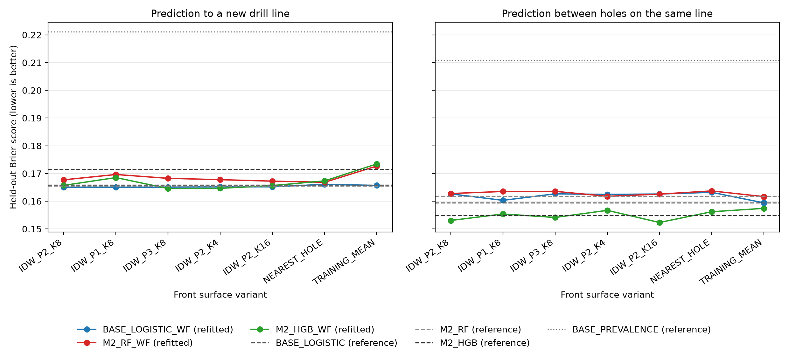
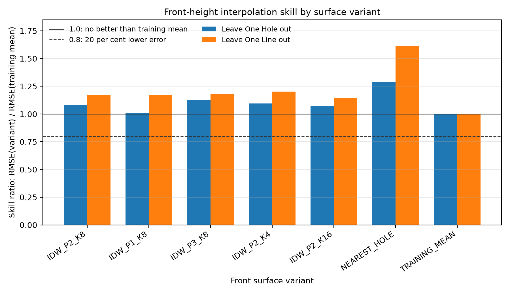

# Weathering-front surface sensitivity analysis

This analysis asks whether the Objective 3 weathering-front predictor depends on how the front height is interpolated between drill holes. The baseline surface is the one used in Objective 3 (inverse-distance weighting, power 2, 8 nearest holes). Each alternative surface refits the three weathering-front candidates with the same outer folds, inner tuning, calibration and random seed. The analysis changes no Objective 3, 4 or 5 result.

## Run record

| item | value |
| --- | --- |
| sensitivity configuration version | SENS-FRONT-CFG-2026.11.07-1 |
| sensitivity configuration SHA-256 | 64dee4867803a5b370a41ceacc1e025c1f59fa5a619b3d2a12d01fd2a421f3af |
| sensitivity configuration reading | as written |
| Objective 3 database SHA-256 (before and after the run) | d02654ee1c2f0bb610450cd89c12eac9903c99dca099c40607089724860fb412 |
| Objective 3 configuration version | O3-CFG-2026.11.06-2 |
| Objective 3 configuration SHA-256 | 47569e360e552b442cef675ba0f709b44d036b783b8e230be0ee1762f98744f3 |
| code commit | b8ede28 |
| receipt used | 1 |
| run started (UTC) | 2026-11-07T11:15:24Z |
| run duration (seconds) | 815.40000 |
| mode | full run |
| bootstrap | hole-cluster, 2000 replicates, seed 20261107, 95% interval |

## Baseline reproduction

The baseline surface was refitted and its calibrated held-out probabilities were compared with the stored Objective 3 values, aligned by observation. The tolerance is 1e-09.

| plan | candidate | max_abs_diff | result |
| --- | --- | --- | --- |
| O3-SPLIT-LODO-1 | BASE_LOGISTIC_WF | 0.00000 | PASS |
| O3-SPLIT-LODO-1 | M2_RF_WF | 0.00000 | PASS |
| O3-SPLIT-LODO-1 | M2_HGB_WF | 0.00000 | PASS |
| O3-SPLIT-HOLE-IL-2 | BASE_LOGISTIC_WF | 0.00000 | PASS |
| O3-SPLIT-HOLE-IL-2 | M2_RF_WF | 0.00000 | PASS |
| O3-SPLIT-HOLE-IL-2 | M2_HGB_WF | 0.00000 | PASS |

## Tables

### S01. Front-height interpolation skill by surface variant

| variant | scheme | rmse_variant_m | rmse_mean_m | skill_ratio |
| --- | --- | --- | --- | --- |
| IDW_P2_K8 | LEAVE_ONE_HOLE_OUT | 4.84946 | 4.49309 | 1.07931 |
| IDW_P2_K8 | LEAVE_ONE_LINE_OUT | 5.56369 | 4.73442 | 1.17516 |
| IDW_P1_K8 | LEAVE_ONE_HOLE_OUT | 4.53357 | 4.49309 | 1.00901 |
| IDW_P1_K8 | LEAVE_ONE_LINE_OUT | 5.55036 | 4.73442 | 1.17234 |
| IDW_P3_K8 | LEAVE_ONE_HOLE_OUT | 5.06853 | 4.49309 | 1.12807 |
| IDW_P3_K8 | LEAVE_ONE_LINE_OUT | 5.58021 | 4.73442 | 1.17865 |
| IDW_P2_K4 | LEAVE_ONE_HOLE_OUT | 4.91881 | 4.49309 | 1.09475 |
| IDW_P2_K4 | LEAVE_ONE_LINE_OUT | 5.68915 | 4.73442 | 1.20166 |
| IDW_P2_K16 | LEAVE_ONE_HOLE_OUT | 4.83285 | 4.49309 | 1.07562 |
| IDW_P2_K16 | LEAVE_ONE_LINE_OUT | 5.41050 | 4.73442 | 1.14280 |
| NEAREST_HOLE | LEAVE_ONE_HOLE_OUT | 5.79400 | 4.49309 | 1.28954 |
| NEAREST_HOLE | LEAVE_ONE_LINE_OUT | 7.64300 | 4.73442 | 1.61435 |
| TRAINING_MEAN | LEAVE_ONE_HOLE_OUT | 4.49309 | 4.49309 | 1.00000 |
| TRAINING_MEAN | LEAVE_ONE_LINE_OUT | 4.73442 | 4.73442 | 1.00000 |

### S02. Held-out Brier score by surface variant and model

| plan | prediction_setting | variant | model | brier |
| --- | --- | --- | --- | --- |
| O3-SPLIT-LODO-1 | Prediction to a new drill line | IDW_P2_K8 | BASE_LOGISTIC_WF | 0.16507 |
| O3-SPLIT-LODO-1 | Prediction to a new drill line | IDW_P2_K8 | M2_RF_WF | 0.16772 |
| O3-SPLIT-LODO-1 | Prediction to a new drill line | IDW_P2_K8 | M2_HGB_WF | 0.16572 |
| O3-SPLIT-LODO-1 | Prediction to a new drill line | IDW_P1_K8 | BASE_LOGISTIC_WF | 0.16507 |
| O3-SPLIT-LODO-1 | Prediction to a new drill line | IDW_P1_K8 | M2_RF_WF | 0.16964 |
| O3-SPLIT-LODO-1 | Prediction to a new drill line | IDW_P1_K8 | M2_HGB_WF | 0.16853 |
| O3-SPLIT-LODO-1 | Prediction to a new drill line | IDW_P3_K8 | BASE_LOGISTIC_WF | 0.16507 |
| O3-SPLIT-LODO-1 | Prediction to a new drill line | IDW_P3_K8 | M2_RF_WF | 0.16826 |
| O3-SPLIT-LODO-1 | Prediction to a new drill line | IDW_P3_K8 | M2_HGB_WF | 0.16457 |
| O3-SPLIT-LODO-1 | Prediction to a new drill line | IDW_P2_K4 | BASE_LOGISTIC_WF | 0.16520 |
| O3-SPLIT-LODO-1 | Prediction to a new drill line | IDW_P2_K4 | M2_RF_WF | 0.16777 |
| O3-SPLIT-LODO-1 | Prediction to a new drill line | IDW_P2_K4 | M2_HGB_WF | 0.16466 |
| O3-SPLIT-LODO-1 | Prediction to a new drill line | IDW_P2_K16 | BASE_LOGISTIC_WF | 0.16520 |
| O3-SPLIT-LODO-1 | Prediction to a new drill line | IDW_P2_K16 | M2_RF_WF | 0.16724 |
| O3-SPLIT-LODO-1 | Prediction to a new drill line | IDW_P2_K16 | M2_HGB_WF | 0.16564 |
| O3-SPLIT-LODO-1 | Prediction to a new drill line | NEAREST_HOLE | BASE_LOGISTIC_WF | 0.16608 |
| O3-SPLIT-LODO-1 | Prediction to a new drill line | NEAREST_HOLE | M2_RF_WF | 0.16684 |
| O3-SPLIT-LODO-1 | Prediction to a new drill line | NEAREST_HOLE | M2_HGB_WF | 0.16733 |
| O3-SPLIT-LODO-1 | Prediction to a new drill line | TRAINING_MEAN | BASE_LOGISTIC_WF | 0.16570 |
| O3-SPLIT-LODO-1 | Prediction to a new drill line | TRAINING_MEAN | M2_RF_WF | 0.17270 |
| O3-SPLIT-LODO-1 | Prediction to a new drill line | TRAINING_MEAN | M2_HGB_WF | 0.17345 |
| O3-SPLIT-LODO-1 | Prediction to a new drill line | not applicable | BASE_PREVALENCE | 0.22113 |
| O3-SPLIT-LODO-1 | Prediction to a new drill line | not applicable | BASE_LOGISTIC | 0.16582 |
| O3-SPLIT-LODO-1 | Prediction to a new drill line | not applicable | M2_RF | 0.16551 |
| O3-SPLIT-LODO-1 | Prediction to a new drill line | not applicable | M2_HGB | 0.17148 |
| O3-SPLIT-LODO-1 | Prediction to a new drill line | not applicable | M1_IK | 0.21938 |
| O3-SPLIT-HOLE-IL-2 | Prediction between holes on the same line | IDW_P2_K8 | BASE_LOGISTIC_WF | 0.16265 |
| O3-SPLIT-HOLE-IL-2 | Prediction between holes on the same line | IDW_P2_K8 | M2_RF_WF | 0.16277 |
| O3-SPLIT-HOLE-IL-2 | Prediction between holes on the same line | IDW_P2_K8 | M2_HGB_WF | 0.15306 |
| O3-SPLIT-HOLE-IL-2 | Prediction between holes on the same line | IDW_P1_K8 | BASE_LOGISTIC_WF | 0.16032 |
| O3-SPLIT-HOLE-IL-2 | Prediction between holes on the same line | IDW_P1_K8 | M2_RF_WF | 0.16352 |
| O3-SPLIT-HOLE-IL-2 | Prediction between holes on the same line | IDW_P1_K8 | M2_HGB_WF | 0.15540 |
| O3-SPLIT-HOLE-IL-2 | Prediction between holes on the same line | IDW_P3_K8 | BASE_LOGISTIC_WF | 0.16266 |
| O3-SPLIT-HOLE-IL-2 | Prediction between holes on the same line | IDW_P3_K8 | M2_RF_WF | 0.16357 |
| O3-SPLIT-HOLE-IL-2 | Prediction between holes on the same line | IDW_P3_K8 | M2_HGB_WF | 0.15414 |
| O3-SPLIT-HOLE-IL-2 | Prediction between holes on the same line | IDW_P2_K4 | BASE_LOGISTIC_WF | 0.16247 |
| O3-SPLIT-HOLE-IL-2 | Prediction between holes on the same line | IDW_P2_K4 | M2_RF_WF | 0.16177 |
| O3-SPLIT-HOLE-IL-2 | Prediction between holes on the same line | IDW_P2_K4 | M2_HGB_WF | 0.15671 |
| O3-SPLIT-HOLE-IL-2 | Prediction between holes on the same line | IDW_P2_K16 | BASE_LOGISTIC_WF | 0.16260 |
| O3-SPLIT-HOLE-IL-2 | Prediction between holes on the same line | IDW_P2_K16 | M2_RF_WF | 0.16256 |
| O3-SPLIT-HOLE-IL-2 | Prediction between holes on the same line | IDW_P2_K16 | M2_HGB_WF | 0.15233 |
| O3-SPLIT-HOLE-IL-2 | Prediction between holes on the same line | NEAREST_HOLE | BASE_LOGISTIC_WF | 0.16321 |
| O3-SPLIT-HOLE-IL-2 | Prediction between holes on the same line | NEAREST_HOLE | M2_RF_WF | 0.16371 |
| O3-SPLIT-HOLE-IL-2 | Prediction between holes on the same line | NEAREST_HOLE | M2_HGB_WF | 0.15621 |
| O3-SPLIT-HOLE-IL-2 | Prediction between holes on the same line | TRAINING_MEAN | BASE_LOGISTIC_WF | 0.15941 |
| O3-SPLIT-HOLE-IL-2 | Prediction between holes on the same line | TRAINING_MEAN | M2_RF_WF | 0.16166 |
| O3-SPLIT-HOLE-IL-2 | Prediction between holes on the same line | TRAINING_MEAN | M2_HGB_WF | 0.15743 |
| O3-SPLIT-HOLE-IL-2 | Prediction between holes on the same line | not applicable | BASE_PREVALENCE | 0.21078 |
| O3-SPLIT-HOLE-IL-2 | Prediction between holes on the same line | not applicable | BASE_LOGISTIC | 0.15942 |
| O3-SPLIT-HOLE-IL-2 | Prediction between holes on the same line | not applicable | M2_RF | 0.16184 |
| O3-SPLIT-HOLE-IL-2 | Prediction between holes on the same line | not applicable | M2_HGB | 0.15483 |
| O3-SPLIT-HOLE-IL-2 | Prediction between holes on the same line | not applicable | M1_IK | 0.17595 |

### S03. Paired Brier difference from the baseline surface (variant minus baseline)

| plan | setting | candidate | variant | brier_variant | brier_baseline | diff | ci_low | ci_high | status |
| --- | --- | --- | --- | --- | --- | --- | --- | --- | --- |
| O3-SPLIT-LODO-1 | Prediction to a new drill line | BASE_LOGISTIC_WF | IDW_P1_K8 | 0.16507 | 0.16507 | -0.00000 | -0.00040 | 0.00039 | UNRESOLVED |
| O3-SPLIT-LODO-1 | Prediction to a new drill line | M2_RF_WF | IDW_P1_K8 | 0.16964 | 0.16772 | 0.00193 | 0.00062 | 0.00324 | RESOLVED |
| O3-SPLIT-LODO-1 | Prediction to a new drill line | M2_HGB_WF | IDW_P1_K8 | 0.16853 | 0.16572 | 0.00281 | 0.00095 | 0.00473 | RESOLVED |
| O3-SPLIT-LODO-1 | Prediction to a new drill line | BASE_LOGISTIC_WF | IDW_P3_K8 | 0.16507 | 0.16507 | 0.00000 | -0.00017 | 0.00018 | UNRESOLVED |
| O3-SPLIT-LODO-1 | Prediction to a new drill line | M2_RF_WF | IDW_P3_K8 | 0.16826 | 0.16772 | 0.00054 | -0.00043 | 0.00154 | UNRESOLVED |
| O3-SPLIT-LODO-1 | Prediction to a new drill line | M2_HGB_WF | IDW_P3_K8 | 0.16457 | 0.16572 | -0.00115 | -0.00463 | 0.00205 | UNRESOLVED |
| O3-SPLIT-LODO-1 | Prediction to a new drill line | BASE_LOGISTIC_WF | IDW_P2_K4 | 0.16520 | 0.16507 | 0.00013 | -0.00091 | 0.00117 | UNRESOLVED |
| O3-SPLIT-LODO-1 | Prediction to a new drill line | M2_RF_WF | IDW_P2_K4 | 0.16777 | 0.16772 | 0.00005 | -0.00144 | 0.00164 | UNRESOLVED |
| O3-SPLIT-LODO-1 | Prediction to a new drill line | M2_HGB_WF | IDW_P2_K4 | 0.16466 | 0.16572 | -0.00106 | -0.00282 | 0.00069 | UNRESOLVED |
| O3-SPLIT-LODO-1 | Prediction to a new drill line | BASE_LOGISTIC_WF | IDW_P2_K16 | 0.16520 | 0.16507 | 0.00013 | -0.00045 | 0.00070 | UNRESOLVED |
| O3-SPLIT-LODO-1 | Prediction to a new drill line | M2_RF_WF | IDW_P2_K16 | 0.16724 | 0.16772 | -0.00048 | -0.00174 | 0.00083 | UNRESOLVED |
| O3-SPLIT-LODO-1 | Prediction to a new drill line | M2_HGB_WF | IDW_P2_K16 | 0.16564 | 0.16572 | -0.00007 | -0.00222 | 0.00196 | UNRESOLVED |
| O3-SPLIT-LODO-1 | Prediction to a new drill line | BASE_LOGISTIC_WF | NEAREST_HOLE | 0.16608 | 0.16507 | 0.00101 | -0.00147 | 0.00373 | UNRESOLVED |
| O3-SPLIT-LODO-1 | Prediction to a new drill line | M2_RF_WF | NEAREST_HOLE | 0.16684 | 0.16772 | -0.00088 | -0.00409 | 0.00212 | UNRESOLVED |
| O3-SPLIT-LODO-1 | Prediction to a new drill line | M2_HGB_WF | NEAREST_HOLE | 0.16733 | 0.16572 | 0.00162 | -0.00257 | 0.00614 | UNRESOLVED |
| O3-SPLIT-LODO-1 | Prediction to a new drill line | BASE_LOGISTIC_WF | TRAINING_MEAN | 0.16570 | 0.16507 | 0.00063 | -0.00133 | 0.00266 | UNRESOLVED |
| O3-SPLIT-LODO-1 | Prediction to a new drill line | M2_RF_WF | TRAINING_MEAN | 0.17270 | 0.16772 | 0.00498 | 0.00094 | 0.00891 | RESOLVED |
| O3-SPLIT-LODO-1 | Prediction to a new drill line | M2_HGB_WF | TRAINING_MEAN | 0.17345 | 0.16572 | 0.00774 | 0.00388 | 0.01166 | RESOLVED |
| O3-SPLIT-HOLE-IL-2 | Prediction between holes on the same line | BASE_LOGISTIC_WF | IDW_P1_K8 | 0.16032 | 0.16265 | -0.00233 | -0.00520 | 0.00021 | UNRESOLVED |
| O3-SPLIT-HOLE-IL-2 | Prediction between holes on the same line | M2_RF_WF | IDW_P1_K8 | 0.16352 | 0.16277 | 0.00075 | -0.00135 | 0.00298 | UNRESOLVED |
| O3-SPLIT-HOLE-IL-2 | Prediction between holes on the same line | M2_HGB_WF | IDW_P1_K8 | 0.15540 | 0.15306 | 0.00234 | -0.00408 | 0.01099 | UNRESOLVED |
| O3-SPLIT-HOLE-IL-2 | Prediction between holes on the same line | BASE_LOGISTIC_WF | IDW_P3_K8 | 0.16266 | 0.16265 | 0.00001 | -0.00055 | 0.00061 | UNRESOLVED |
| O3-SPLIT-HOLE-IL-2 | Prediction between holes on the same line | M2_RF_WF | IDW_P3_K8 | 0.16357 | 0.16277 | 0.00080 | -0.00261 | 0.00414 | UNRESOLVED |
| O3-SPLIT-HOLE-IL-2 | Prediction between holes on the same line | M2_HGB_WF | IDW_P3_K8 | 0.15414 | 0.15306 | 0.00108 | -0.00126 | 0.00347 | UNRESOLVED |
| O3-SPLIT-HOLE-IL-2 | Prediction between holes on the same line | BASE_LOGISTIC_WF | IDW_P2_K4 | 0.16247 | 0.16265 | -0.00018 | -0.00050 | 0.00008 | UNRESOLVED |
| O3-SPLIT-HOLE-IL-2 | Prediction between holes on the same line | M2_RF_WF | IDW_P2_K4 | 0.16177 | 0.16277 | -0.00100 | -0.00190 | -0.00020 | RESOLVED |
| O3-SPLIT-HOLE-IL-2 | Prediction between holes on the same line | M2_HGB_WF | IDW_P2_K4 | 0.15671 | 0.15306 | 0.00365 | -0.00221 | 0.01209 | UNRESOLVED |
| O3-SPLIT-HOLE-IL-2 | Prediction between holes on the same line | BASE_LOGISTIC_WF | IDW_P2_K16 | 0.16260 | 0.16265 | -0.00005 | -0.00012 | 0.00001 | UNRESOLVED |
| O3-SPLIT-HOLE-IL-2 | Prediction between holes on the same line | M2_RF_WF | IDW_P2_K16 | 0.16256 | 0.16277 | -0.00021 | -0.00067 | 0.00027 | UNRESOLVED |
| O3-SPLIT-HOLE-IL-2 | Prediction between holes on the same line | M2_HGB_WF | IDW_P2_K16 | 0.15233 | 0.15306 | -0.00074 | -0.00239 | 0.00075 | UNRESOLVED |
| O3-SPLIT-HOLE-IL-2 | Prediction between holes on the same line | BASE_LOGISTIC_WF | NEAREST_HOLE | 0.16321 | 0.16265 | 0.00056 | -0.00096 | 0.00211 | UNRESOLVED |
| O3-SPLIT-HOLE-IL-2 | Prediction between holes on the same line | M2_RF_WF | NEAREST_HOLE | 0.16371 | 0.16277 | 0.00095 | -0.00250 | 0.00407 | UNRESOLVED |
| O3-SPLIT-HOLE-IL-2 | Prediction between holes on the same line | M2_HGB_WF | NEAREST_HOLE | 0.15621 | 0.15306 | 0.00315 | -0.00060 | 0.00719 | UNRESOLVED |
| O3-SPLIT-HOLE-IL-2 | Prediction between holes on the same line | BASE_LOGISTIC_WF | TRAINING_MEAN | 0.15941 | 0.16265 | -0.00324 | -0.00655 | -0.00038 | RESOLVED |
| O3-SPLIT-HOLE-IL-2 | Prediction between holes on the same line | M2_RF_WF | TRAINING_MEAN | 0.16166 | 0.16277 | -0.00111 | -0.00491 | 0.00251 | UNRESOLVED |
| O3-SPLIT-HOLE-IL-2 | Prediction between holes on the same line | M2_HGB_WF | TRAINING_MEAN | 0.15743 | 0.15306 | 0.00436 | 0.00006 | 0.00878 | RESOLVED |

### S04. Lowest-Brier model by surface variant

| plan | setting | variant | lowest_brier_model | lowest_brier | o4_selected | same_as_o4 | wf_beats_parent_logistic | wf_beats_parent_rf | wf_beats_parent_hgb |
| --- | --- | --- | --- | --- | --- | --- | --- | --- | --- |
| O3-SPLIT-LODO-1 | Prediction to a new drill line | IDW_P2_K8 | BASE_LOGISTIC_WF | 0.16507 | BASE_LOGISTIC_WF | True | True | False | True |
| O3-SPLIT-LODO-1 | Prediction to a new drill line | IDW_P1_K8 | BASE_LOGISTIC_WF | 0.16507 | BASE_LOGISTIC_WF | True | True | False | True |
| O3-SPLIT-LODO-1 | Prediction to a new drill line | IDW_P3_K8 | M2_HGB_WF | 0.16457 | BASE_LOGISTIC_WF | False | True | False | True |
| O3-SPLIT-LODO-1 | Prediction to a new drill line | IDW_P2_K4 | M2_HGB_WF | 0.16466 | BASE_LOGISTIC_WF | False | True | False | True |
| O3-SPLIT-LODO-1 | Prediction to a new drill line | IDW_P2_K16 | BASE_LOGISTIC_WF | 0.16520 | BASE_LOGISTIC_WF | True | True | False | True |
| O3-SPLIT-LODO-1 | Prediction to a new drill line | NEAREST_HOLE | M2_RF | 0.16551 | BASE_LOGISTIC_WF | False | False | False | True |
| O3-SPLIT-LODO-1 | Prediction to a new drill line | TRAINING_MEAN | M2_RF | 0.16551 | BASE_LOGISTIC_WF | False | True | False | False |
| O3-SPLIT-HOLE-IL-2 | Prediction between holes on the same line | IDW_P2_K8 | M2_HGB_WF | 0.15306 | M2_HGB_WF | True | False | False | True |
| O3-SPLIT-HOLE-IL-2 | Prediction between holes on the same line | IDW_P1_K8 | M2_HGB | 0.15483 | M2_HGB_WF | False | False | False | False |
| O3-SPLIT-HOLE-IL-2 | Prediction between holes on the same line | IDW_P3_K8 | M2_HGB_WF | 0.15414 | M2_HGB_WF | True | False | False | True |
| O3-SPLIT-HOLE-IL-2 | Prediction between holes on the same line | IDW_P2_K4 | M2_HGB | 0.15483 | M2_HGB_WF | False | False | True | False |
| O3-SPLIT-HOLE-IL-2 | Prediction between holes on the same line | IDW_P2_K16 | M2_HGB_WF | 0.15233 | M2_HGB_WF | True | False | False | True |
| O3-SPLIT-HOLE-IL-2 | Prediction between holes on the same line | NEAREST_HOLE | M2_HGB | 0.15483 | M2_HGB_WF | False | False | False | False |
| O3-SPLIT-HOLE-IL-2 | Prediction between holes on the same line | TRAINING_MEAN | M2_HGB | 0.15483 | M2_HGB_WF | False | True | True | False |

### S05. Conclusion by prediction setting

| plan | setting | conclusion | n_resolved | n_selection_changes |
| --- | --- | --- | --- | --- |
| O3-SPLIT-LODO-1 | Prediction to a new drill line | PERFORMANCE_SENSITIVE | 4 | 4 |
| O3-SPLIT-HOLE-IL-2 | Prediction between holes on the same line | PERFORMANCE_SENSITIVE | 3 | 4 |

## Figures

Figure SF01 (also as PDF: ../../figures/sensitivity/SF01_front_surface_sensitivity.pdf). Each panel is one prediction setting; each point is one refitted candidate under one surface; dashed lines are the reference models, dotted line is the prevalence baseline.

Figure SF02 (also as PDF: ../../figures/sensitivity/SF02_front_skill.pdf). Skill ratio below 1 is better than the training mean; the 0.8 line marks a 20 per cent reduction in error.

## Conclusion by setting

- **Prediction to a new drill line** (O3-SPLIT-LODO-1): PERFORMANCE_SENSITIVE. 4 paired difference(s) resolved; the lowest-Brier model changed under 4 surface variant(s) compared with the Objective 4 selection.
- **Prediction between holes on the same line** (O3-SPLIT-HOLE-IL-2): PERFORMANCE_SENSITIVE. 3 paired difference(s) resolved; the lowest-Brier model changed under 4 surface variant(s) compared with the Objective 4 selection.

## Interpretation

- Baseline surface, leave one hole out: RMSE of the predicted front height is 4.85 m against 4.49 m for the training mean (skill ratio 1.08). A ratio below 1 means the surface predicts held-out front heights better than the training mean.
- Baseline surface, leave one line out: RMSE of the predicted front height is 5.56 m against 4.73 m for the training mean (skill ratio 1.18). A ratio below 1 means the surface predicts held-out front heights better than the training mean.
- Prediction to a new drill line (O3-SPLIT-LODO-1): 4 of 18 paired differences from the baseline surface are resolved (95 per cent hole-cluster interval excludes zero). The lowest-Brier model under the baseline surface is BASE_LOGISTIC_WF, the Objective 4 selection is BASE_LOGISTIC_WF. The lowest-Brier model changes under 4 alternative surface(s): IDW_P2_K4, IDW_P3_K8, NEAREST_HOLE, TRAINING_MEAN.
  The largest paired difference is M2_HGB_WF under TRAINING_MEAN: +0.00774 in Brier score (interval +0.00388 to +0.01166).
  Conclusion for this setting: PERFORMANCE_SENSITIVE.
- Prediction between holes on the same line (O3-SPLIT-HOLE-IL-2): 3 of 18 paired differences from the baseline surface are resolved (95 per cent hole-cluster interval excludes zero). The lowest-Brier model under the baseline surface is M2_HGB_WF, the Objective 4 selection is M2_HGB_WF. The lowest-Brier model changes under 4 alternative surface(s): IDW_P1_K8, IDW_P2_K4, NEAREST_HOLE, TRAINING_MEAN.
  The largest paired difference is M2_HGB_WF under TRAINING_MEAN: +0.00436 in Brier score (interval +0.00006 to +0.00878).
  Conclusion for this setting: PERFORMANCE_SENSITIVE.
- Lowest-Brier model changes are reported as they occur. The Objective 4 comparisons among the leading models were themselves unresolved, so a change of lowest-Brier model is not read as a better model.
